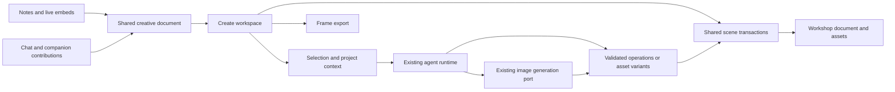

# Creative workspace epic

> **Status:** Canvas first agreed 2026-10-21; backend foundation and durable creative dispatch implemented.
> Scene-engine selection, canvas UI and the end-to-end creation journey remain open.
> **Scope:** Expand Drawing into a practical place to sketch, compose, refine,
> and export creative work with Medousa's brain.
> **First release:** S0–S3, ending in one complete human-and-AI creation loop.
> **Related:** [Expressive Chat](expressive-chat-media-ink-liquid-epic.md),
> [media and attachments](media-and-attachments-plan.md),
> [interaction and state model](interaction-and-state-model.md),
> [Drawing guide](../docs/guides/drawing.md),
> [chat media guide](../docs/guides/chat-media-and-images.md).

## Outcome

An engineer or everyday creator can start with an idea, screenshot, image, or
rough sketch and leave with a useful artifact. They can work directly with
their hands, direct an AI at a selection, and continue editing the result.

Borrow expressive ink and approachable layers from Procreate; editable objects,
frames, and alignment from Figma; and image composition, cropping, and masks
from Photoshop. Keep everyday tasks easy to discover and finish.

The first release should make a release graphic, annotated screenshot, simple
diagram, or UI concept achievable without requiring design-tool expertise.
The broader vision adds richer illustration, reusable visual styles, image
repair, and project-aware assistance.

## Locked product decisions

- **Create is its own main view.** Use **Create** as the working navigation
  label alongside Chat, Code, Reviews and Notes. Its home is a project browser,
  with recent and pinned creative projects and clear starting points: blank
  canvas, screenshot markup, diagram, UI concept and image composition.
- **Projects use the existing shell.** The Create rail navigates projects and
  their assets; selecting a project activates its existing shell tab or opens
  one. Selecting the main navigation item shows the Create browser without
  opening an arbitrary previous project. Frames and layers belong inside the
  project, while shell tabs and splits use the established app behavior.
- **A creative project owns one document.** It has a stable workshop-scoped
  identity, editable scene, durable assets and document history independent of
  a chat or note. Views share revisions and undo; switching surfaces must not
  fork the work or discard a draft. Duplicate is an explicit action.
- **Notes embed the work.** A note can reference a project or frame and offer
  **Open in Create**. That action opens the same source. Existing drawing notes
  retain a supported editing path, with identity adoption and migration designed
  before implementation; opening them must not silently create unrelated copies.
- **Chat contributes and shares.** Chat and companion workflows can send
  references or generated assets into a chosen project. Sharing a live project
  reference and sending a rendered snapshot are distinct actions; an already
  sent snapshot does not change when the source is edited.
- **AI stays contextual.** Reuse Ask and the existing @ target picker with a
  small transcript/progress area. Selection supplies context, the canvas stays
  primary, and a full conversation is available through the existing session.
- **Canvas first is the chosen layout** (selected 2026-10-21). Give the canvas
  most of the workspace, with a compact floating tool strip and contextual Ask
  below it. Keep projects in the rail; reveal layers, properties and references
  on demand rather than reserving a permanent inspector column.

These decisions fix the product model and layout direction. Detailed control
behavior, rail details, scene engine and physical storage format remain design
or spike decisions.

## Experience principles

1. **The work occupies the canvas.** A compact tool strip, contextual inspector,
   optional layer list, and lightweight Ask interaction leave room to create.
2. **Selection supplies context.** An object, several objects, a frame, or a
   painted region can be the target of an explicit AI request.
3. **Human and AI edits remain understandable.** Direct edits, generated assets,
   and proposed changes have clear boundaries and a shared undo model.
4. **Editability is honest.** Text, shapes, paths, and frames remain structured.
   A generated bitmap is an image layer; converting it to editable objects is a
   separate operation with a preview of what was recovered.
5. **Experimenting preserves the source.** Variants appear beside their source.
   Crops and masks preserve original bytes. Replacing work is an explicit action.
6. **Defaults carry the experience.** Useful sizes, palettes, alignment, and
   export presets come first; advanced properties appear when relevant.
7. **Create is the primary workspace.** Notes and Chat embed, reference and
   contribute to the same creative documents through their existing surfaces.

### Reference journeys

| Journey | Direct manipulation | Brain assistance | Finished work |
|---|---|---|---|
| Release graphic | Import a screenshot, crop, add a title and frame | Propose three treatments using selected project references | Export one frame as PNG; retain editable source |
| UI concept | Sketch boxes, annotate, select a region | Suggest a layout made of editable text and shapes | Rearrange it manually and export SVG or PNG |
| Explain a system | Draw relationships, add labels and screenshots | Align selected objects and clarify selected labels | Save an editable diagram and share a rendered copy |
| Illustration or image repair | Sketch, paint a mask, compose image layers | Generate a selected region or refine an image | Compare variants, keep one, continue painting |

The first three journeys drive the first release. Region generation and richer
painting arrive in S4; the UI must describe which actions are available.

## Existing foundations and gaps

| Existing implementation | Reuse | Required extension |
|---|---|---|
| `apps/medousa-home/src/lib/draw/drawDocument.ts` | Versioned drawing data, stable stroke IDs, pressure/tilt and brush metadata | Mixed objects, hierarchy, transforms, frames, referenced assets |
| `drawInput.ts`, `drawGeometry.ts`, `drawCamera.ts`, `DrawSurface.svelte` | Stylus behavior, erasing, lasso, camera and responsive surface | Object selection, handles, snapping and mixed rendering |
| `drawHistory.ts` | Changed-stroke patches and labeled undo | Bounded transactions across objects, ordering, assets and masks |
| `DrawNoteEditor.svelte`, `liveDrawSurface.ts` | Vault-native drawing notes and embedded drawings | New scene version, compatibility previews and durable asset references |
| `drawMedia.ts`, `ChatDrawingDialog.svelte` | Editable source plus rendered preview, daemon media transport | Frame exports, real alpha, mixed scenes and document-owned assets |
| `src/image_generation.rs` | Provider-neutral request/port, image references, cancellation and generation lineage | Creative-document context, durable result ownership and selection/mask capabilities |
| Spotlight/companion addressed conversations | Target selection and lightweight conversation surfaces | Explicit creative context and selection-bound actions |

Current drawing source is a version-2 stroke document encoded in a Markdown
`draw` fence, with a 2 MiB payload bound. Camera movement is broader than its
persisted coordinate limits. Image generation currently resolves references
from session media and persists outputs with the session. These limits need
deliberate migration and ownership work before mixed creative documents ship.

The older Expressive Chat epic deliberately excluded shapes and layers. This
epic extends that scope while retaining its existing compatibility and device
validation obligations.

## Architecture and ownership

### Scene and assets

- Propose a version-3 scene with stable IDs for ink, text, basic shapes, images,
  groups, and frames. Masks join this model in S4. Keep transforms, parent IDs,
  ordering, visibility, locks, opacity, and asset references explicit.
- Keep world coordinates independent of export frames. Preserve old drawings'
  positions and dimensions during migration; opening and leaving an old drawing
  must not rewrite it. Saving an edit upgrades through a tested migration.
- Store creative projects through the workshop's existing filesystem/vault
  authority; a project does not require a containing Markdown note. S0 decides
  the source format and resource layout, including compatibility for existing
  drawing notes. Images and other large assets stay in daemon-owned resources.
  Enforce explicit bounds without silent truncation or silently increasing the
  existing fence limit.
- Notes and other live embeds resolve a stable document/frame reference. Define
  identity adoption for legacy inline drawings, reference recovery after moves,
  and explicit copy behavior before implementing the new entry points.
- A document owns durable references to its imported and generated assets.
  Reuse existing media/attachment services with a promotion or ownership bridge;
  deleting a source chat must not break a saved creative document.
- Treat originals as immutable assets. Undo retains asset references while
  needed; garbage collection accounts for documents, versions, jobs and history.
  Large image bytes do not live in every object snapshot or undo entry.
- Relative asset references, portable export packaging, missing-asset handling,
  and cross-workshop copying are part of the persistence design.

### Interaction and commands

One editor command path handles local manipulation and validated AI proposals:
create/update objects, transform selections, reorder/reparent, change text or
styles, reference assets, and later update masks. A gesture or accepted AI edit
is one labeled transaction. Camera, hover, selection, and inspector state are
view state; they do not create document revisions or model turns.

Keep pointer sampling, camera changes and ink rendering local. Batch durable
writes after gestures through the existing vault path. Do not serialize the
whole scene on every pointer sample. Multiple panes may view a document, but
durable writes must share revision checks and preserve conflicting drafts.

### Brain context and creative jobs

An explicit request captures the workshop/document identity, base revision,
selected object IDs and fingerprints, selection bounds, a bounded visual
preview, and structured object data. Add relevant project references, approved
style references and conversation context within the same workshop scope.
Capture this context at submission so a later selection cannot redirect a job.

Reuse the existing agent runtime, addressed targets, inference profiles, media
services and Activity lifecycle. The document service now owns durable native
creative-job/result association and captures structured document/revision/selection
snapshots. Addressed targets, visual previews, project/style references and Activity
presentation remain integration work; a closed canvas must not orphan accepted
work. Generation uses the
existing image-generation port. Capability reporting distinguishes image
generation, reference editing and mask editing; missing capabilities produce
an actionable result rather than a pretend local edit.

AI returns a validated object-operation proposal or generated asset variants.
Check referenced IDs, bounds, object types, assets and expected revisions before
applying it. A result computed against changed targets stays a separate proposal
or variant; it must not overwrite newer human work. Cancellation and retries
use stable job IDs so a resumed request cannot apply twice.

The workspace uses a small contextual Ask field and short progress/results
presentation. Reuse the @ target picker where a target is useful. The drawing
remains visible and usable while work runs.

### Authority and portable behavior

- The workshop daemon owns document files, asset resolution and generated
  bytes. Co-located pickers and Reveal follow `workshopLocality`; remote browsing
  and imports follow existing workshop-authorized paths and media transport.
- Keep provider credentials and provider requests behind existing runtime and
  image ports. This epic does not introduce an auth service or user setup flow.
- AI-authored text, SVG and object payloads are inert validated data. Arbitrary
  executable canvas widgets require a separate design and the existing browser
  sandbox boundaries.
- Saving, previewing, version recovery, and explicit conflict handling work
  across local and remote workshops. Older readers receive a useful static
  representation and preserve unsupported source rather than stripping it.

## Backend foundation delivered

Implemented independently of a scene renderer:

- `medousa-create` owns strict mixed-scene validation, atomic workshop persistence,
  per-project locking, revision-fenced command batches, idempotent retries and
  bounded shared undo/redo. Future source versions remain untouched.
- `/v1/create/projects` exposes authenticated native content APIs, generated
  contracts and Rust/Python SDK helpers. Home uses the existing workshop-bound
  operation bridge; no separate auth service or provider-specific backend exists.
- Project-owned immutable bitmap assets can be imported or promoted from existing
  session media under its deletion lease. Assets survive scene undo and source
  chat deletion; collection is deliberately deferred until all retained references
  can be accounted for.
- Selection context and persisted edit proposals extend existing store tools.
  Accepting a proposal is an ordinary undoable transaction; stale revisions and
  changes outside the captured selection are rejected.
- Durable creative-job admission captures the base before dispatch through the
  existing native runtime. Queued jobs recover; ambiguous in-flight work is fenced
  as interrupted instead of replayed. Results remain selection-bound proposals,
  staged images do not invalidate their own base, and acceptance is undoable.
- Home has renderer-free shared sessions, bounded clean-session eviction, retained
  failed drafts/history requests, inert document references and pure legacy-ink
  migration. A shared TypeScript/Rust fixture checks the migration boundary.

This does not complete S0 or S1–S3 as user-facing releases. The measured engine
spike, Notes adoption/rendering UI, actual canvas tools, export renderer and full human/AI creation journey still need
integration. Existing Drawing behavior is unchanged. See the implemented
[service contract](../docs/engine/creative-workspace.md) for storage limits and
current behavior; the slices below retain their complete acceptance criteria.

## Delivery slices

Delivery is planned. Check boxes mark completed planning or implementation
deliverables, not intent.

### S0 — Experience and engine decision

- [x] Record Create's navigation, project ownership, embedding and contextual
  interaction decisions, with a common brief for the first mocks below.
- [x] Compare the initial screenshot-composition layouts and select Canvas
  first. The broader task and device studies below remain open.
- [ ] Mock three connected tasks: compose a screenshot graphic, refine selected
  ink, and turn a sketch into an editable layout. Cover desktop, pen tablet and
  a compact phone inspector without introducing separate editor products.
- [ ] Spike the existing SVG/ink surface against an established scene editor.
  Evaluate tldraw as a candidate using the same scene and input fixtures.
- [ ] Record engine integration, license/distribution fit, Svelte integration,
  offline behavior, stylus feel, accessibility and rendering/export fidelity in
  an ADR. Keep Medousa's source and command contracts independent of that choice.
- [ ] Lock the document/asset ownership design, migration path and first-release
  capability list before coupling UI work to a new scene format.

**Exit:** An agreed interaction direction and a small measured engine prototype;
existing notes, ink and remote workshop behavior have a viable preservation path.

#### Mock direction and remaining studies

The initial mocks compared Canvas first, Frame first and Reference first using
the same Medousa shell and screenshot release graphic. **Canvas first was
selected on 2026-10-21.** Continue from that layout, with the inspector available
on demand. Keep the same product model while exploring the remaining journeys.

Show these connected states rather than isolated toolbar studies:

1. **Create home:** recent/pinned projects, the project rail and useful starters.
2. **Open project:** one shell tab, a generous canvas, named frame, imported
   screenshot, compact tools and approachable layers/properties.
3. **Selected work:** selection handles, contextual properties and Ask with an
   @ target. Show exactly what will be sent as context.
4. **Working and result:** quiet progress, variants beside the original,
   explicit acceptance and an understandable undo action.
5. **Continue elsewhere:** switch away and return with the draft intact; open
   the same project/frame from a Notes embed using Open in Create.

Then carry the chosen arrangement through editable sketch-to-layout and a
compact phone view. Pen interaction must retain an unobstructed drawing area.
If a mock explores region refinement, mark it as S4 rather than implying it is
part of the first release. Engine selection must not dictate the mock's chrome.

### S1 — Mixed document and durable assets

- [ ] Implement the versioned scene, migration fixtures and immutable asset refs.
- [ ] Add stable project/document identity, project/frame embed references and
  legacy drawing adoption without duplicating existing work.
- [ ] Generalize transactions and bounded undo/redo; support revision-fenced saves.
- [ ] Support ink, images, editable text, basic shapes, groups and named frames.
- [ ] Promote source/generated session media into document ownership and test
  that documents survive deletion of the originating session.
- [ ] Restore a saved scene after restart, including missing-asset recovery and
  preservation of unsupported future-version source.

**Exit:** A mixed document round-trips without losing ink, text, ordering or
assets, and a conflicting save retains both versions of the user's work.

### S2 — Everyday composition

- [ ] Add the Create browser and project/asset rail using existing shell tabs,
  splits and navigation; preserve drafts and view state when switching projects.
- [ ] Open a Notes project/frame embed in Create against the same source.
- [ ] Import images and screenshots; create text, shapes and export frames.
- [ ] Move, resize, rotate, duplicate, group, align and snap selections, with
  keyboard access to selection and property controls.
- [ ] Add approachable layer ordering, hide/show, lock and opacity controls.
- [ ] Add non-destructive rectangular image cropping and preserve existing
  pressure brushes, partial erasing, lasso, touch pan and pinch zoom.
- [ ] Export a frame as PNG, including genuine transparent alpha, and SVG for
  supported content. Distinguish the editor backdrop from the export background.

**Exit:** A person can compose and export a useful screenshot graphic manually,
then reopen and edit its original text, crop, frame and ink.

### S3 — Selected work and AI iteration

- [ ] Add selection-bound Ask through the existing runtime and target model.
- [ ] Deliver a narrow set of typed object edits: arrange, align, relabel and
  restyle selected objects. Introduce editable sketch-to-layout as a previewed
  proposal with a clearly stated supported object vocabulary.
- [ ] Generate or refine an image using captured references; place variants
  beside the source and allow explicit insertion/replacement as image layers.
- [ ] Preserve job progress across navigation/reconnect and show retry/cancel
  through the existing Activity conventions.
- [ ] Handle stale selections, changed documents, duplicate completion events,
  provider failures and unavailable capabilities without losing local edits.

**Exit — first release:** Start a Create project, import a screenshot, draw and add editable text, ask
for variations, choose one, make another manual edit, undo the accepted AI
change, save/reopen, and export a frame. Repeat on a remote workshop. The same
release also demonstrates one AI operation on editable objects. Confirm the
everyday desktop and pen-tablet journeys on hardware, and a useful phone
view/annotation flow with recoverable saves. Open a Notes embed in Create and
verify that edits, assets and undo belong to the same document.

### S4 — Image editing and expressive craft

- [ ] Add painted/lasso masks, clipping and simple blend modes with export parity.
- [ ] Add region refinement, background removal and image cleanup through
  capability-aware jobs. Preserve originals and expose understandable variants.
- [ ] Improve brush presets, stabilization and shape assistance, with live
  preview and predictable pen/eraser behavior on actual tablet hardware.

**Exit:** Combine ink and images, refine only a chosen region, adjust its mask
manually, and undo the full operation without modifying the original asset.

### S5 — Project context and reusable design

- [ ] Add explicit style/reference sets using project context and selected assets.
- [ ] Offer reusable palettes, text styles, simple components and frame presets.
- [ ] Add assisted layout and diagram cleanup with editable results, predictable
  alignment and short explanations when a request needs a different capability.
- [ ] Keep context choice visible: users can see which project/style references
  an AI request used and substitute them for a different direction.

**Exit:** Reuse a visual treatment across a graphic, diagram and UI concept,
change its references, and obtain useful alternatives without rebuilding each.

### S6 — Handoff and production readiness

- [ ] Package editable scenes with their assets; add batch frame export and PDF
  through existing export paths where fidelity is supported.
- [ ] Add reusable assets to existing library/project workflows and preserve
  references when copying between authorized workshops.
- [ ] Hand selected assets/context to existing Code or external-agent workflows.
  Implementation work follows normal Code/Forge custody and review.
- [ ] Complete accessibility, font fallback, memory, renderer and device checks;
  document supported imports/exports and capability-specific limitations.

**Exit:** A recipient can reopen an editable package or use a rendered export
without relying on the originating chat, browser cache or temporary URLs.

### Dependencies and release boundaries

`S0 → S1 → S2 → S3` delivers the first usable release. Build selection context
and command adapters alongside S1/S2 so AI integration does not arrive as an
unrelated second editor. `S4` and `S5` extend that release; either can proceed
first after their shared document foundations are stable. `S6` expands handoff
and completes broader production readiness. Each slice ships in reviewable,
independently validated increments.

## Validation and quality budgets

Define repeatable benchmark fixtures in S0: small everyday compositions, a dense
ink document, a many-object layout and a multi-image collage. Measure a desktop,
an actual pen tablet, a phone and a remote workshop; record device and scale
with the results. Proposed targets are a responsive 60 Hz manipulation path on
the baseline desktop/tablet and no visible ink regression against today's Draw.
Lock numerical latency and memory budgets from the spike before implementation.

Required evidence includes:

- Golden v1/v2 migrations, mixed-scene serialization, corrupt/future-version
  handling, and transparent/opaque export fixtures.
- Transaction inversion for transforms, reordering, grouping, text edits, masks
  and accepted AI changes; bounded history holds asset refs instead of copies.
- User edits arriving during a job, cancelled/retried jobs, stale revisions,
  duplicate results, failed uploads and reconnect after the canvas closes.
- Save/reopen on a remote workshop, conflict recovery, session deletion after
  durable promotion, and portable export without local filesystem assumptions.
- Create navigation without accidental tabs, draft restoration after project
  switches, and shared source/history across shell splits and Notes embeds.
- Legacy drawing adoption, moved/missing embed targets and explicit duplication;
  edits to a live source must not mutate previously sent chat snapshots.
- Real pen pressure/tilt and palm/touch behavior; mouse/keyboard access to
  creation, selection, layers, properties and export without requiring gestures.
- Viewport culling, bounded image decode/thumbnail caches, disposal when tabs
  close, and consistent rendering between preview, PNG and supported SVG.

Implementation slices update `docs/guides/drawing.md` and relevant guide indexes
when behavior ships. New API/SDK contracts update engine/SDK docs and generated
contracts through their existing tooling. Run repository-required checks for
those implementations; this planning change does not claim runtime validation.

## Deferred scope

Full PSD/Figma interchange, professional prepress/CMYK, animation/video editing,
3D, exhaustive brush/plugin systems, live multiplayer conflict resolution,
arbitrary executable canvas nodes and a general visual workflow builder are
outside the first release. Future prototypes may explore these independently
without making them prerequisites for finishing everyday creative work.

## Decisions to settle in S0

| Decision | Planning position | Evidence needed |
|---|---|---|
| Editor engine | Retain proven ink behavior; choose the scene foundation after the spike | Stylus feel, mixed-scene interaction, Svelte integration, export and maintenance cost |
| Source storage | Independent workshop-owned projects with portable source; assets are external references | Large-document bounds, asset lifecycle and older-client fallback |
| Legacy identity and embeds | Open the same document from Create or Notes; copies are explicit | Identity adoption, move recovery, deletion behavior and migration fixtures |
| AI interaction layout | Contextual Ask with selected work and existing addressed targets | Mocks and complete first-release journey |
| First generative capability | Reuse configured image generation/reference editing; report capabilities honestly | Durable document references and end-to-end result placement |

## External references

Reviewed 2026-10-21 as interaction and integration references:

- [tldraw AI integrations](https://tldraw.dev/docs/ai): visual plus structured
  context and editor actions are useful patterns for selection-directed work.
- [Agent starter kit](https://tldraw.dev/starter-kits/agent) and
  [image pipeline starter kit](https://tldraw.dev/starter-kits/image-pipeline).
- [tldraw quick start](https://tldraw.dev/quick-start): its editor is integrated
  as a React component, which needs an explicit integration choice in this
  Svelte application.
- [tldraw licensing](https://tldraw.dev/community/license): production use
  requires an appropriate license/key. Evaluate fit for Medousa's distribution
  and self-hosted use before selecting it as a shipping dependency.
