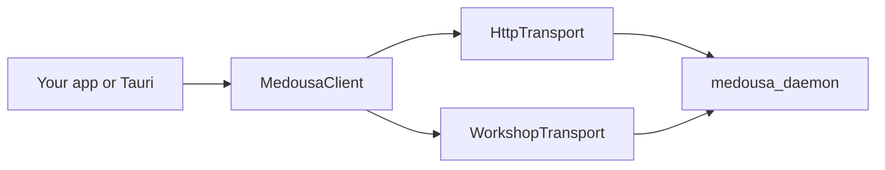

# Medousa SDK

Shared client libraries for talking to **medousa_daemon** without duplicating HTTP paths or serde types.

**Docs:** [API reference](api-reference.md) · [Python SDK](python.md) · [Interactive streaming](interactive-streaming.md) · [Transports](transports.md) · [Artifacts](artifacts.md) · [Examples](examples/README.md)

Coder tool contracts and local diagnostics: [Usage attribution and batch edits](../engine/coder-efficiency.md).

Human project shells use the native-only `sessions.workspace_shell.post`
operation and the selected workshop's `AdminExecute` authority. Its folder
context does not grant a Forge execution lease or produce sealed task evidence;
see [Coding engine integration](../engine/coding-engine.md#daemon-routes).

Assistant ownership queries and signed paired-workshop completion retrieval:
[Coordination contracts](../engine/coordination.md). The peer-only completion
query requires the exact saved proposal association and signed mesh envelopes;
an ordinary bearer-only SDK request does not supply that authority.

Native agent messages also use signed `mesh.agents.messages.post` exchanges
between paired daemons. Discovery, durable delivery, status, and one-way reply
mailboxes are documented in [Cross-workshop transport](../engine/coordination.md#cross-workshop-transport).
Generated operation metadata includes the route; public SDK callers do not
receive a bearer-only messaging API.

Full-daemon assistant handoffs expose typed sender responsibility, completion,
callback and contact policy. Direct admission is tied to the current human
request; proposal admission remains available. Inbox records carry optional
`PeerHandoffSummary` metadata, and sender review requires the exact terminal receipt.
See [Sender-owned handoffs](../engine/coordination.md#sender-owned-local-handoffs).

Remote handoffs export a recent immutable transcript range bounded by both entry
count and serialized bytes. The model-facing `cognition_peer_delegate` tool also
accepts exact source entry bounds; automatic selection can include bounded,
source-scoped Locus continuity. See [Bounded handoff context](../engine/coordination.md#bounded-handoff-context).

Project Markdown images use `forge.items.by_work_id.source.get` with query
`path=<project-relative-image>&image=true`. The JSON response is
`{path,mime,bytes_base64}` instead of the text source response. PNG, JPEG, GIF,
WebP, SVG, and AVIF reads are capped at 2 MiB and remain scoped to the governed
workshop working copy, including symlink and `.git` restrictions. Omitting
`image` preserves the existing source response. See [Forge routes](../engine/forge.md).

Admitted assistant turns can use `work.create_project` to create an owned
undertaking in an existing workshop Git repository, including one with no
commits. Creation returns native graph references and a Forge work ID without
binding the assistant chat or launching an executor. See
[Undertaking creation](../engine/work-units.md#undertaking-creation-from-an-admitted-turn).

Work-scoped native execute/review uses runtime actions `work.coordinate` and
`work.coordination`. Provider participants access owner-domain work through
`POST /v1/work/query` and `POST /v1/work/mutate` using scoped, revocable credentials.
Registration accepts exact native proposal IDs and each stage waits for its
existing grant. Registered proposal dispatch can return the existing nullable
`binding` while queued. See [Work scopes and native coordination](../engine/work-units.md#native-executor--reviewer-coordination)
and [Provider work participant adapters](../engine/external-conversations.md#work-participant-adapters).

Work event inboxes use `work.events` plus explicit actor-bound acknowledgment.
Provider sends can attach exact `work` scope metadata, and current self Work
credentials report outcomes through
`external_conversations.by_id.work_events.post`. These callbacks retain exact
request/result association and qualified revision-bound review evidence without
automatically satisfying work. See [Correlated work callbacks](../engine/external-conversations.md#correlated-work-callbacks).

## Packages

| Package | Role |
|---------|------|
| [`medousa-types`](../../crates/medousa-types/) | Serde DTOs for daemon API (`daemon_api`, `session`, `local`, …) |
| [`medousa-sdk`](../../crates/medousa-sdk/) (Rust) | `MedousaClient` + `HttpTransport` + reconnecting SSE |
| [`medousa-sdk`](../../python/medousa-sdk/) (Python) | Async `MedousaClient`, SSE streaming, reconnecting SSE, `MedousaClientSync` |
| [`medousa-sdk-iroh`](../../crates/medousa-sdk-iroh/) | `WorkshopTransport` — pooled LAN + route cache + optional Iroh hook |
| [`medousa-host`](../../crates/medousa-host/) | Spawn `medousa_local`, binary resolution, bind probes |
| [`@medousa/client`](../../packages/medousa-client/) | Dependency-free TypeScript client for external surfaces (VS Code, Neovim, Obsidian) |

## Quick start (async)

```rust
use std::sync::Arc;
use reqwest::header::{AUTHORIZATION, HeaderMap, HeaderValue};
use medousa_sdk::{HttpTransport, MedousaClient};

let bearer = std::env::var("MEDOUSA_TOKEN")?;
let mut headers = HeaderMap::new();
let mut authorization = HeaderValue::from_str(&format!("Bearer {bearer}"))?;
authorization.set_sensitive(true);
headers.insert(AUTHORIZATION, authorization);
let http = reqwest::Client::builder().default_headers(headers).build()?;
let client = MedousaClient::with_transport(
    Arc::new(HttpTransport::with_client(http)),
    "http://127.0.0.1:7419",
);

let health = client.health().get().await?;
let sessions = client.sessions().list(20).await?;
```

The bearer is required for protected routes even on loopback. External clients
should obtain a paired credential and store it in an OS secret store; do not
reuse Medousa's private first-party local credentials.

## `MedousaClient` accessors

| Accessor | Purpose |
|----------|---------|
| `health()` | Protected runtime health and contract identity |
| `http()` | Generic GET/POST/PUT/PATCH/DELETE |
| `ingest()` | Channel ingest |
| `local_models()` | Local inference probe & downloads |
| `jobs()` | Headless ask |
| `recurring()` | Cron prompts |
| `sessions()` | Session history & append |
| `interactive()` | Start streaming turn |
| `runtime()` | Artifacts, config, stage-route commands |
| `capabilities()` | Capability catalog |
| `mcp_gateway()` | Gateway status |
| `budget()` | Turn budget approve/deny |
| `vault()` | Multi-root notes library |
| `calendar()` | Personal calendar (vault `.ics`) |
| `workspace()` | Work board cards & feed |

Full method table: [api-reference.md](api-reference.md) · contract: [`../../sdk-contract/openapi.json`](../../sdk-contract/openapi.json)

Vault search accepts `VaultSearchQuery.root_id` in Rust and `root_id=` in the
async and sync Python clients. An explicit root searches its titles/paths without
changing the active editing vault; check `VaultSearchResponse.root_id` against
the requested root before displaying results. See [vault search](../engine/vault.md#multi-root--obsidian)
for matching behavior and scan limits.

Provider-hosted Muse and Grok Bot conversations currently use the generic authenticated
`http()` transport. See the [external conversation HTTP contract](../engine/external-conversations.md)
for endpoints, event IDs, and callback authentication.

## Transport diagram



See [transports.md](transports.md).

## Tauri desktop & medousa-home

`apps/medousa-home/src-tauri/src/daemon/sdk.rs` builds a [`medousa-sdk-iroh`](../../crates/medousa-sdk-iroh/) `WorkshopTransport` (pooled LAN clients + route cache; mobile adds `TauriIrohHook` for Iroh tickets). JSON daemon calls route through [`workshop_http.rs`](../../apps/medousa-home/src-tauri/src/daemon/workshop_http.rs).

Interactive/workspace SSE in the webview uses Tauri event bridges plus [`reconnect.ts`](../../apps/medousa-home/src/lib/stream/reconnect.ts) for `?since=<seq>` replay — there is no published `@medousa/sdk` npm package for Tauri. Multipart uploads still use legacy `workshop_transport` byte helpers.

Artifact routes use typed `client.runtime().artifact_*()`.

Spawn offline brain via `medousa_host` — **not** `POST /v1/local/engine/load` (removed; daemon is probe-only).

## Types

Rust: `medousa_types`. Python: `medousa.types` (generated — see [python.md](python.md)).

```rust
use medousa_types::{ArtifactFetchRequest, ArtifactListUiRequest};

let list = client.runtime().artifact_list_ui(&ArtifactListUiRequest {
    session_id: None,
    limit: 50,
    query: None,
}).await?;
```

## Sync clients

`BlockingMedousaClient` (Rust) and `MedousaClientSync` (Python) mirror the same accessors without SSE.

## Channel adapters & TUI

Telegram/Discord/Slack bins use `client.ingest().post()`. TUI uses `MedousaClient` in `src/bin/medousa_tui/daemon_commands.rs`.

## Contributing

When adding SDK methods, register them on `DeclaredRouter` / `ContractRouter` and regenerate `sdk-contract/openapi.json` with `UPDATE_API_CONTRACT=1 cargo test -p medousa --lib daemon::contract::tests::checked_in_contract_artifacts_match_generation`.

## Hosted repository reviews

Rust clients use `client.reviews().providers().await` and
`client.reviews().query(&query).await` with the shared `ReviewProviderQuery` DTO.
Handle `ReviewProviderResponse.outcome` explicitly: provider errors use the typed
error outcome, even when transport succeeded. Low-level generated operations
`reviews.providers.get` and `reviews.query.post` are also available to other
clients. `client.reviews().authenticate(&request)` coordinates device sign-in;
`client.reviews().mutate(&request)` publishes an already-pushed branch. Their
generated operations are `reviews.auth.post` and `reviews.mutate.post`. Sign-in
returns public user codes and connection IDs, never access tokens. The package runs on the connected workshop, with no local CLI required
by the SDK. See [Review-provider protocol](../engine/review-providers.md).

Hosted review queries also support account-relative PR inboxes and CI details.
The provider-neutral mutation DTO supports comments/replies, review decisions
with inline comments, PR editing/lifecycle/reviewer requests, revision-pinned
merges, incremental label edits, pending-review request removal, and workflow rerun/cancel.
Paginated `labels`, `reviewer_candidates`, and `reviewers` queries supply repository
catalogs and normalized review decisions. `merge_conflicts` remains separate from
CI/approval state; check `kind`/`actions` keep native check IDs opaque. Providers advertise supported operation names;
see [review providers](../engine/review-providers.md) for revision and retry rules.


### Creative documents

The workshop-owned Create backend supports versioned mixed scenes, atomic edits,
undo/redo, project-owned bitmap assets and selection-bound proposals. See the
[creative document service](../engine/creative-workspace.md) for DTOs, bounds,
revision conflicts and retry rules. Rust and Python callers use `client.creative()`; operations use the generated
`create.projects.*` family; the main Create canvas uses the same document API.
Removing a frame or group removes its entire subtree in the same transaction;
undo restores the descendants and their order. See the service contract for
batch removal and admission retry semantics.
Version-3 nodes may include an optional `name` layer label (nonblank, at most
256 UTF-8 bytes). Generated Rust, Python, and TypeScript models expose it; legacy
unnamed nodes omit it. This field requires an updated daemon. Group/ungroup edits
reuse the ordinary atomic transaction operations rather than a separate API.
Text content supports optional `font_weight` (100–900) and `font_style`
(`normal`/`italic`); omitted values mean 400/normal. These also require an updated
daemon and are exposed by all generated models. Preserve them when updating text.
Line shapes support optional `line` geometry with local `start`/`end` points,
`start_arrow`, `end_arrow`, and `dashed` (booleans default false). Omission preserves
legacy box-diagonal endpoints. These version-3 fields also require an updated
daemon. Endpoint, style, and rotation edits use ordinary atomic transactions and
undo; preserve the geometry when updating a line.

Creative nodes also accept optional `appearance` (rounded corners and shadows)
and text-only `text_layout` (wrap width, alignment and line spacing). They use
ordinary `put_node` transactions and history; omitted fields preserve legacy
version-3 defaults. See the [creative document contract](../engine/creative-workspace.md)
for bounds and supported node kinds. Update the daemon before sending these fields.

Creative jobs use `creative().create_job`, `jobs`, `job` and `decide_job` in both
Rust and Python. Preserve the request ID/body when retrying admission; use a new
ID to retry an interrupted execution. Read the job result before explicitly
accepting against its captured document revision. See the
[creative service contract](../engine/creative-workspace.md#durable-creative-jobs)
for recovery, cancellation and capacity behavior.

For visual context, call `import_asset` with `CreativeAssetImportRequest.context`
containing `expected_revision` and `selected_ids`, plus a bounded PNG in
`data_base64`. This stages a snapshot without advancing the canvas revision.
Pass the returned asset ID as `CreativeJobRequest.visual_asset_id`. The daemon
also supplies original selected image assets as session media references.
Continue a conversation with `parent_job_id`; set `refine_proposal` to refine a
current unapplied preview with the same selection. Each result still requires
explicit acceptance against the captured revision. Finished requests are archived
without losing their admission identity; `jobs` returns recent work and `job`
can read an archived request by ID. Generated models include the optional fields
and the `superseded` job status; upgrade the daemon before sending them.

Creative job reads include optional `base_nodes`, the original selected nodes
before preview refinements. Ready/stale results can apply to the latest supplied
revision when field changes reconcile safely. Conflicting edits preserve the
result; they never trigger regeneration or overwrite current work. Updated app
and daemon builds are required for this behavior.

Creative Code handoffs use `client.creative().code_context(id, request)` in Rust
and `client.creative().code_context(id, request)` in Python (async and sync). The
request binds a saved frame revision and matching preview asset to a session;
the response contains selection context and session media refs for the existing
Code turn API. See [the creative service contract](../engine/creative-workspace.md#code-handoffs-and-browser-design-capture).


Browser operation `browser.worlds.isolated.by_world_id.design_capture.page.post`
returns `BrowserDesignPageCapture`: ordered slices with captured scene/pixels,
`clip_top`, `height`, and `page_y`. Scene imports can retain original image assets
in frame `design_source.original_asset_id`. Text layouts accept tracking,
paragraph spacing, underline and bounded UTF-16 inline spans. See the
[creative contract](../engine/creative-workspace.md) for validation and capture limits.

Isolated browser creation accepts `view_attached: false` for offscreen capture
(default `true`). After a daemon restart, `takeover` explicitly reopens a stopped
world under user control; `resume` returns it to agent control. See
[isolated browser lifecycle](../engine/http-api.md#isolated-browser-worlds).
